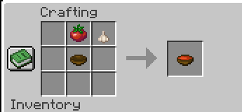
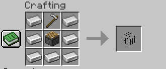

# Harvest Mod
Harvest Mod is a Minecraft harvesting mod that adds a lot of new stuff like new crops, mobs, and items.<br>
Made with <3 by Mustafa & Nullskulls.

---

## Items
You can find all the items in the creative inventory under the "Harvest Mod" tab.

- **Tomato** - Edible and can be used as an ingredient for crafting.
- **Tomato Seed** - Can be planted to grow TomaTOES.
- **Tomato Soup** - Edible and can be crafted using [This Recipe](https://github.com/MustafaBioS/harvest-mod/blob/main/README.md#Recipes).
- **Garlic** - Stinky, will cause hunger and will not give you any hunger bars back.
- **Garlic Seed** - Can be planted to grow Garlic.
- **Mustafa Spawn Egg** - Used to spawn the Mustafa variant of the Crop Thief entity.
- **Nullskulls Spawn Egg** - Used to spawn the Nullskulls variant of the Crop Thief entity.

---

## Blocks

### Harvester Block

A block that can be used to sacrifice your hoe to automatically harvest crops. It can be crafted using
[This Recipe](https://github.com/MustafaBioS/harvest-mod/blob/main/README.md#Recipes)

To use the block, you must first place it down (obviously), then sacrifice your hoe to it (each hoe has its own range and cooldown depending on the materials spent to create it). After you're done using the harvester, you may take back your hoe. Using the harvester chips away at your hoe's durability so be careful!!


| Hoe           | X Range   | Y range   | Cooldown |
|---------------|-----------|-----------|----------|
| Wooden Hoe    | 4 Blocks  | ±0 Blocks | 20 Ticks | 
| Stone Hoe     | 6 Blocks  | ±0 Blocks | 15 Ticks |
| Iron Hoe      | 8 Blocks  | ±0 Blocks | 10 Ticks |
| Golden Hoe    | 8 Blocks  | ±0 Blocks | 2 Ticks  |
| Diamond Hoe   | 12 Blocks | ±1 Blocks | 5 Ticks  |
| Netherite Hoe | 16 Blocks | ±1 Blocks | 2 Ticks  |

### Planter Block

A block that can be used to sacrifice your hoe to automatically plant crops. It can be crafted using
[This Recipe](https://github.com/MustafaBioS/harvest-mod/blob/main/README.md#Recipes)

You also need to sacrifice a hoe to use the block; the planter, unlike the harvester, has two upgrade paths; a path to upgrade the planter's planting ability and
another to increase its seed holding capacity.

To use the planter, you first want to obviously place it down afterward sacrificing a hoe to fuel it. You should then right-click the planter holding seeds
in your hand to deposit seeds.

Each hoe recharges the planter by a set number of usages. The following table reflects how much each repairs.

| Hoe           | How Much Repaired |
|---------------|-------------------|
| Wooden Hoe    | 200 Usages        |
| Stone Hoe     | 800 Usages        |
| Iron Hoe      | 3600 Usages       |
| Golden Hoe    | 1600 Usages       |
| Diamond Hoe   | 6000 Usages       |
| Netherite Hoe | 9000 Usages       |


To upgrade your planter's planting ability, you're going to want to sacrifice ores to it by right-clicking it.
each ore upgrades your planter to a certain extent depending on its rarity. upgrading your planter grants you lower cooldowns.
the following table describes each ore's ability to upgrade your planter. It at the moment is very unbalanced, but that's intentional.
By default, your planter starts with 100 ticks as its cooldown, and it can only drop as low as 3 ticks.

| Ore           | Cooldown Reduction |
|---------------|--------------------|
| Golden Ingot  | 5 Ticks            |
| Golden Nugget | 1 Tick             |
| Gold Block    | 15 Ticks           |
| Iron Block    | 10 Ticks           |
| Iron Ingot    | 3 Ticks            |
| Iron Nugget   | 0 Ticks            |
| Diamond Ore   | 15 Ticks           |

Giving your planter emerald ore increases its capacity by 20 seeds maxing out at 256.

---

## Recipes
You can also craft the "Tomato Soup" item using the following recipe:

```
Tomato + Garlic + Bowl = Tomato Soup
```

**in the following pattern:**



You can also craft the "Harvester Block" using the following recipe:

```
Iron Ingot + Iron Hoe + Piston = Harvester Block
```

**in the following pattern:**


You can also craft the "Planter Block" using the following recipe:

```
Iron Ingot + Iron Hoe + Dispenser = Planter Block
```

**in the following pattern:**



there will be more recipes soon once we make updates to this mod.

---

## Entities

### Crop Thief
We currently only have the "Crop Thief" entity with the Mustafa variant, and the Nullskulls variant, which 
chases after your crops destroying them and stealing them. You can get your crops back by killing them.
Spawn them by using the spawn eggs in the creative inventory.

---

## Download

Harvest-Mod uses **Fabric**, Minecraft Version **1.21.x**.

---

## License

This template is available under the CC0 license. Feel free to learn from it and incorporate it in your own projects.

